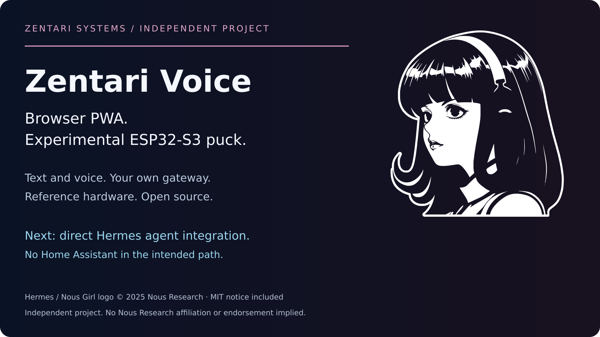
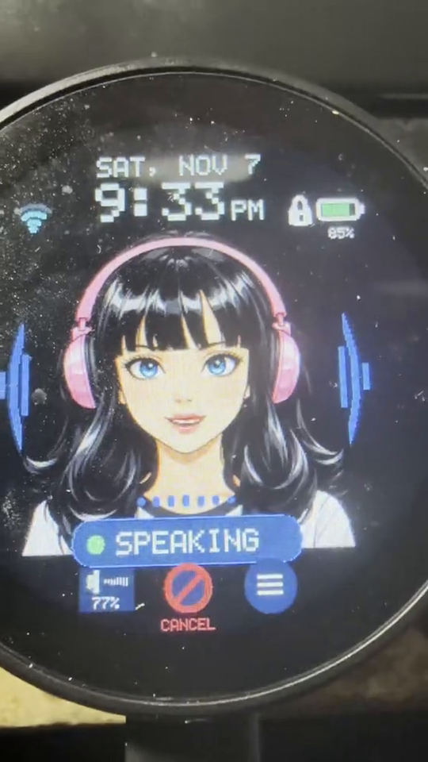
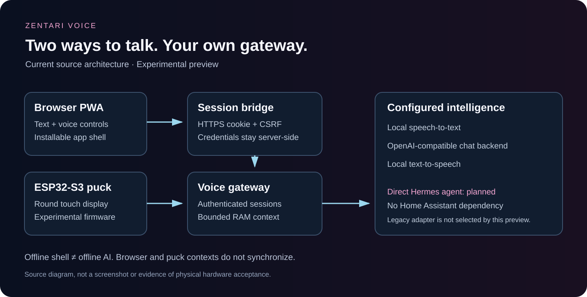

# Zenti by Zentari

**One Hermes voice agent across your phone and puck, with actions you can see
and control.** That is the direction of this independent Zentari project.

Today, the source provides an installable **browser PWA**, a local-first voice
gateway, and experimental **round ESP32-S3 puck** firmware. Talk, type, cancel a
reply, and reset a conversation. Use the browser without hardware, or explore
the reference puck. Direct Hermes, cross-device handoff and visible agent-action
approval are planned; they are not enabled by the current quick start.

**Experimental source preview.** The browser demo is scripted. Hardware source is
experimental. A stable 1.0 release is not accepted; see [release status](docs/RELEASE-STATUS.md).

[Install the PWA](docs/INSTALL.md#install-the-browser-pwa) ·
[Puck parts and materials](docs/PUCK-MATERIALS.md) ·
[Architecture](docs/ARCHITECTURE.md)



Hermes / Nous Girl logo © 2025 Nous Research, used with its
[MIT notice](third_party/nous-research/LICENSE). This is an independent Zentari
project; no Nous Research affiliation or endorsement is implied.

## Watch the physical puck

[Watch the owner-recorded puck demo (14 seconds, MP4)](docs/media/video/puck-demo-2026-11-07.mp4)

<a href="docs/media/video/puck-demo-2026-11-07.mp4"></a>

Recorded on the owner's installed puck, supplied as the November 7 demo. It
shows touch-to-talk and the Listening, Thinking and Speaking states. The frame
above is taken from that video, not a render or browser screenshot. The clip
does not identify the firmware commit, backend or model, and does not establish
acceptance of this public source. [Media sources and limits](docs/media/README.md).

## Browser app or physical puck?

| | Browser PWA | Experimental puck |
| --- | --- | --- |
| Where it runs | Desktop or mobile browser; standalone app window on supported browsers | Waveshare ESP32-S3-Touch-LCD-1.85C BOX Rev2 |
| Controls | Text, hold-to-talk, mute, cancel, settings and local transcript export | Round 360×360 touch display, hold-to-talk, menu and volume controls |
| What it needs | A trusted HTTPS gateway and configured chat/speech models | Reviewed firmware/configuration plus a reachable gateway and model services |
| Offline | Cached app shell; voice and AI still need the gateway | No on-device model inference claim |

The no-account web demo below is a separate scripted tour. It is not the live
PWA or an AI benchmark. Browser and puck conversation contexts do not synchronize.



**Hermes direction:** direct Hermes agent integration, without Home Assistant,
is the intended next step. The current standalone entrypoint uses an
OpenAI-compatible chat backend; it does not activate the included legacy Hermes
adapter or expose an agent's tools. See [integration scope](docs/HERMES-INTEGRATION.md).

## What works, what is experimental, what comes next

| Status | Scope |
| --- | --- |
| **Implemented in source** | Browser text/voice controls, Stop, mute, reset, local transcript export, PWA installation metadata and offline shell; authenticated gateway with a configured chat backend |
| **Experimental** | Reference puck firmware, physical controls, signed-approval and OTA source; remaining hardware, battery, recovery and soak acceptance is documented |
| **Planned** | Direct Hermes agent integration; phone-to-puck conversation handoff; visible agent actions with approval before consequential steps; a simpler guided setup |

The planned experience centers on five things:

- **Direct Hermes:** use the agent through the voice gateway without requiring Home Assistant.
- **Phone and puck together:** continue the same conversation across devices, with explicit session ownership and reset behavior.
- **Visible actions:** show what the agent wants to do and keep approval, cancellation and results understandable.
- **Clear privacy controls:** make microphone, memory, export/reset and any external model routing visible.
- **Simple setup:** guide users from models and a trusted gateway to an installed PWA or a correctly configured puck.

Cross-device context, real Hermes tools and their approval flow still need
implementation and end-to-end verification. A screenshot or demo does not move
a planned feature into the implemented column.

## Try the web demo — no account or hardware

Python 3.11+ is enough. From this directory:

```bash
python3 tools/build_site.py
python3 -m http.server 8080 --bind 127.0.0.1 --directory dist/site
```

Open <http://localhost:8080>. Everything stays in the page: no model, microphone,
network API, analytics, account, or stored messages. **Stop** cancels the pending
scripted reply. This is an interaction demo, not a live AI performance claim.
The same seven-file site can be served from a GitHub project Pages subdirectory.

## Run the real browser client on Linux

Requires Ubuntu 24.04+, Docker with Compose v2, Python 3.11+, OpenSSL, a local
OpenAI-compatible chat backend, and separately licensed STT/TTS models. Start
with a machine with at least 8 GB RAM; the gateway is capped at 4 GB and four CPUs.
Model performance depends on the CPU and model. No inference speed is promised.

1. Run your local backend with a model you have already installed. The default
   configuration targets Ollama's OpenAI-compatible `/v1` API on port 11434 and
   model `qwen3.5:4b`; choose the exact name your backend serves with `--model`.
   Make the backend reachable from this container using its restricted host
   interface. Do not expose Ollama to the public internet.
2. Put a CTranslate2 faster-whisper model in `models/stt/` (including `model.bin`,
   `config.json`, `tokenizer.json`, and its `vocabulary.txt` or `vocabulary.json`); put a Piper voice in `models/voice.onnx` and
   its configuration in `models/voice.onnx.json`. Review each model card and
   license before downloading or redistributing it. Weights are not included.
   See [model integrity](docs/INSTALL.md#model-integrity).
3. Create private configuration in an ordinary Linux terminal:

```bash
python3 -m venv .venv
.venv/bin/python -m pip install -r pwa/requirements-bridge.txt
.venv/bin/python tools/setup.py
printf 'ZENTI_UID=%s\nZENTI_GID=%s\n' "$(id -u)" "$(id -g)" > .env
.venv/bin/python tools/doctor.py
openssl x509 -in .runtime/ca.pem -noout -fingerprint -sha256
docker compose up --build -d --wait
.venv/bin/python tools/doctor.py --live
```

Setup asks for a hidden password of at least 16 characters and generates a
dedicated browser identity, a 30-day expiry, and local TLS material. Never paste
the private files into an issue. It refuses an existing configuration directory.
Only trust `.runtime/ca.pem` in your local browser/OS after checking the
displayed SHA-256 fingerprint against that file. Never import `server-key.pem`.
Open <https://localhost:8443>, open **Settings**, and sign in. Do not bypass TLS
verification. [Installation](docs/INSTALL.md) covers trust, models and recovery.

The default Compose publishes only host loopback. It creates no public endpoint,
cloud subscription, privileged mount, Docker socket, or production enrollment.
For a remote HTTPS backend, pass `--allow-remote --backend` explicitly during
setup and store its optional API key in `.runtime/backend-key` with mode 600.
There is no automatic paid fallback. Model requests leave the gateway only for
the configured backend; read its retention terms before opting in.

## Daily controls

- **Hold to talk:** starts capture while held. Microphone access is requested
  only after an explicit user action.
- **Mute microphone:** stops input; it preserves an already playing reply.
- **Cancel response / Stop audio:** cancels processing and queued playback.
- **Hands-free:** half duplex; it pauses input during replies. Stop it with
  microphone mute. Wake words and full duplex are not supported.
- **New conversation:** resets server context and clears the visible transcript.
- **Settings:** microphone selection, volume, neutral Zenti/Orbit avatars,
  voice replies, and reduced motion. Preferences stay on that browser.

Conversation memory is RAM-only, bounded to 16 messages/12 KB per conversation,
64 conversations and a 30-minute idle expiry. It is scoped to authenticated
device plus server-bound principal. A browser bridge is a single-owner service,
not a multi-user account system; its password sessions share that owner's
conversation. Browser and puck contexts do not synchronize. No raw audio or
transcript logs are enabled. Explicit Markdown export downloads a local file.

## Hardware and development

The reference board is Waveshare ESP32-S3-Touch-LCD-1.85C BOX Rev2. See the
[parts and materials guide](docs/PUCK-MATERIALS.md) for the display, audio,
enclosure, power, battery and host-computer requirements. See the upstream
revision and pin provenance in [hardware](hardware/pinmap.json) and
[vendor notices](third_party/waveshare/UPSTREAM.md). Similar names do not establish
pin compatibility. ESP-IDF 6.1 is the firmware baseline.

```bash
cmake -S tests/host -B build/host
cmake --build build/host
ctest --test-dir build/host --output-on-failure
python3 -m unittest discover -s scripts/tests -p 'test_*.py'
python3 -m unittest discover -s tests -p 'test_*.py'
node --test tests/pwa/*.test.cjs
npm ci --prefix tests/pwa --ignore-scripts
node tests/pwa/node_modules/playwright/cli.js install chromium firefox webkit
node --test tests/pwa/browser.e2e.cjs tests/pwa/demo.e2e.cjs
```

Browser tests use synthetic microphones, identities, and speech/model fixtures.
They do not prove phone audio, a real model, or charging. Firmware, approval,
OTA and hardware recovery instructions and limits are in [the hardware guide](docs/HARDWARE.md).
Do not flash the accepted private installation with this preview.

## Source, privacy and contribution

- [Architecture and protocol](docs/ARCHITECTURE.md)
- [Security and reporting](SECURITY.md) · [Threat model](docs/THREAT-MODEL.md)
- [Contributing](CONTRIBUTING.md) · [Support](SUPPORT.md) · [License inventory](docs/LICENSES.md)
- [Release and rollback](docs/RELEASE.md) · [Changelog](CHANGELOG.md)

The source export has no private repository history, production configuration,
customer records or model weights. Procedural public artwork is generated from
source; the earlier standalone reference portraits remain omitted. Presentation
media separately includes the official upstream Hermes logo with its MIT notice
and owner-supplied hardware footage; see [media provenance](docs/media/README.md).
Existing Apache-2.0 and vendor notices are retained. The owner selected Apache-2.0 for the Zentari-owned
source, including the extracted gateway; third-party licenses remain separate.
Private security and conduct contact: [info@zentarisystems.io](mailto:info@zentarisystems.io).
See [the license inventory](docs/LICENSES.md) and [maintainer procedure](docs/MAINTAINER.md).
