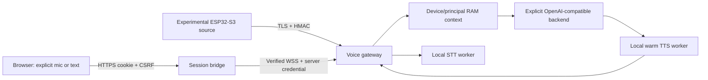

# Architecture and protocol

The browser never receives the gateway HMAC secret or backend API key. Cookie
sessions are Secure, HttpOnly, SameSite=Strict, have a fixed eight-hour lifetime,
and require exact origin/Host and CSRF for state changes. Login hashing and
attempts are bounded. Logout/expiry close active sockets and revoke replay.
The bridge serves only `pwa/client`; private configuration is outside that root.

The device protocol is `zentari.voice.v1`, version `v: 1`. Authentication is
`device.hello → auth.challenge → auth.prove → session.accepted`, using
HMAC-SHA256 over `zv1\n{challenge_id}\n{nonce}\n{device_id}\n{generation}\n{hello_id}`
and unpadded base64url proof. A rejected version/subprotocol fails closed.
An established event must carry authenticated device/session IDs, monotonically
increasing sequence and UUID turn correlation. Clients cannot choose principals.

`conversation.open/reset` returns `conversation.ready` and capabilities.
`text.input` and `audio.input.start/chunk/stop` trigger a bounded turn.
Replies emit `transcript.final`, `assistant.thinking`, `assistant.text`,
`audio.output.start/chunk/stop`; `cancel` ends work and suppresses late audio.
See [schemas and vectors](../protocol/v1/README.md) for exact examples.

| Invariant | Bound |
| --- | --- |
| Input audio | PCM16 LE, mono, 16 kHz; 15 seconds / 480,000 bytes |
| Output audio | Same PCM; 60 seconds / 1,920,000 bytes |
| Chunk / wire frame | 1,024 decoded bytes / 4,096 JSON bytes |
| Turn / backend HTTP | 150 seconds / 28 seconds |
| Gateway socket queue / open connections | 8 / 16 |
| Conversation | 16 messages, 12 KB, 30-minute idle lifetime, maximum 64 |
| Browser sessions | Maximum 8; one active WebSocket per session |

The public gateway checks registry expiry on authentication and each event;
generation revocation is rechecked during the session. Idle connections are
bounded by the 900-second session TTL. Existing sessions do not get an immediate
push when an operator edits expiry; the next event enforces it. Shutdown and
cancel join adapter cleanup before releasing the single inference worker.

Only an explicitly configured backend receives model requests. HTTP redirects
are refused; response size, history roles, text size and time are bounded.
Unknown provider error text is replaced by a fixed category. No tools, shell,
filesystem agent, managed production runtime or automatic provider fallback is
exposed. Optional private legacy adapter source is included for provenance and
tests but is never selected by the standalone entrypoint.

The compatibility claim for this candidate is the current browser plus the v1
fixture-tested gateway. A new physical firmware/web/gateway combination requires
its own acceptance; no candidate inherits acceptance from an older installation.
